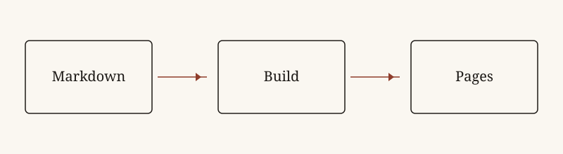

A post is a Markdown file in `src/content/posts/`. The header sets the page title, the pin, and the lines around them. Everything under it is the text.

## Header

```yaml
---
title: Writing in Markdown
description: One sentence, shown under the title and in lists.
date: 2026-10-04
category: Notes
pinned: false
draft: false
---
```

- `title` is the heading of the page, and the link in lists.
- `description` is the sentence under that heading.
- `date` is shown next to the category. Posts are ordered from newest to oldest.
- `category` is the link in the header. It also fills the category page.
- `pinned: true` adds the pin icon and keeps the post in the Pinned section on the home page, even when it is not one of the three latest.
- `draft: true` keeps the post off the site.

## A section heading

A paragraph can include **bold**, *italic*, and `inline code`. External links stay external, for example [GitHub Pages](https://pages.github.com/).

### A subsection

Lists and quotes work as usual.

- First item
- Second item, with an [internal link](/about/) to another page
- Third item

1. Write the file
2. Check it locally
3. Push to `main`

> A quote stands apart from the text, with no extra layout.

## Image

Images placed next to the post are included in the site. The path is relative to the Markdown file.



The usual formats (`png`, `jpg`, `webp`, `gif`, `svg`) use the same syntax.

## Code

```js
const posts = await getCollection("posts");
const visible = posts.filter((post) => !post.data.draft);
```

## Table

| Format | Use |
| --- | --- |
| `png`, `jpg`, `webp` | Photos |
| `svg` | Drawings |
| `gif` | Motion |

---

A task list, if you want one as a checklist:

- [x] Write the text
- [ ] Reread
- [ ] Remove `draft`
